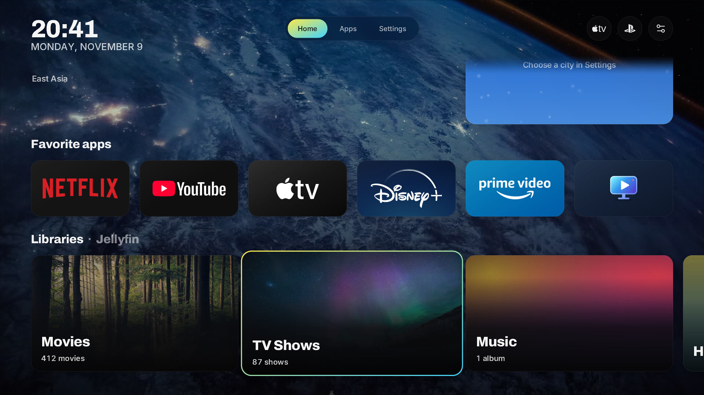
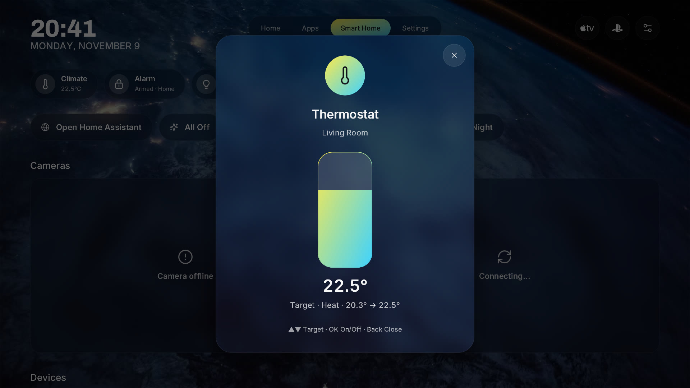
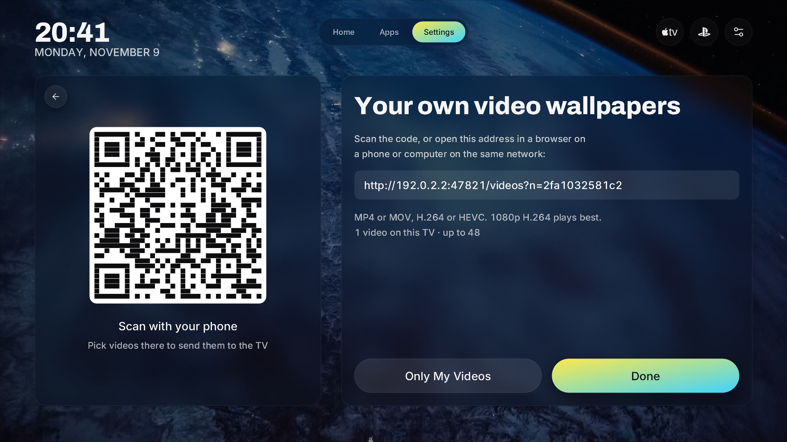
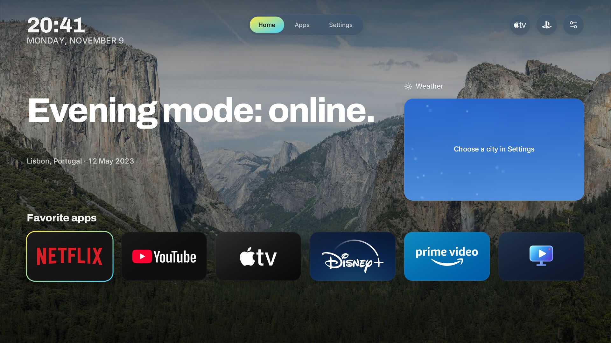

# Luma: LG webOS TV Launcher

**A fast, remote-first launcher and home screen for LG webOS TVs, with an Apple TV feel.**

Luma replaces the cluttered LG Home with one calm screen: your favorite apps, live video wallpapers, widgets, your Jellyfin library, your PC games over Moonlight and your Home Assistant devices. It's a native Rust app drawn with OpenGL ES, so it stays smooth on TV hardware.

Free and open source (MIT). Fork it, change it, ship it.

> [!NOTE]
> **This is a fork.** It builds Luma **2.5.0** under its own app ID, **`com.archbtw.luma`**, so it
> installs beside the original Luma (`com.denisefremov.luma`) with its own settings. What differs
> from the original:
>
> - Video wallpapers are the default, and you can upload your own videos from a phone or computer.
> - The Home headline and greetings are tech themed.
> - LG's own apps start hidden.
> - The crypto widget is removed.
> - A command-line autostart hook (`autostart.sh`) is included.
> - Home Assistant devices can be controlled (thermostats, locks, media players, covers and more), and
>   the Home Assistant web interface opens from the Smart Home tab.
> - A Jellyfin **Libraries** row shows every library as a wide banner card.
> - The wallpaper can be a photo frame fed by an ImmichFrame server.
> - Jellyfin plays files as they are (Direct Play first), keeps HDR in HDR, and has Version and
>   Quality pickers.
> - Home shows a Switch button for every HDMI input with a picture.
>
> The promo video and most screenshots below show the original Luma, so headline text and widgets
> look a little different from this build.

<a href="https://github.com/funnymataleao/luma-webos-launcher/releases/download/v2.2.160/Luma-promo.mp4"></a>

▶ [Watch the original Luma promo video (1 min)](https://github.com/funnymataleao/luma-webos-launcher/releases/download/v2.2.160/Luma-promo.mp4)


## Features

**Home**

- Each layout arranges Home its own way. **Classic**: headline and weather on top, Favorites, then the content rows. **Shelf** (Rail): Favorites and the HDMI switch buttons first, then the headline beside the weather, with a content row already in view. **Stage** (Dock): the wallpaper keeps the top of the screen, the widgets sit in its corner, and the headline, switch buttons and Favorites rest low above the dock. **Mirror**: widgets on the left, the headline and the Favorites title set against the right edge. Up and Down follow each arrangement from top to bottom.
- With the Magic Remote, click anywhere beside the apps, buttons and widgets and Home clears away to the wallpaper (the screensaver's animation). Any key or click brings it back.
- A Jellyfin tile in Favorites (the Jellyfin app's own tile when it is a favorite, else one Luma adds at the end, one press of Left from your first app). Jellyfin's rows show only while that tile is selected: the headline, its caption and the widgets fade out, and Favorites and the Jellyfin rows glide up to fill the screen. Down goes into the rows and Up comes back to the tile. Hold OK on Luma's tile to move it like any app.
- Favorite apps row and "stacks": rows of content from Jellyfin, Moonlight and more, each capped at 20 cards with a **View Library** page behind it.
- Live video wallpapers, on by default: Apple and Amazon aerials played in hardware. Pick whole collections or single clips.
- Your own video wallpapers: **Settings › Wallpaper › Upload Videos** shows a QR code. Open it on a phone or computer on the same network and pick MP4/MOV files (H.264 or HEVC). They play from the TV's storage, and **Only My Videos** rotates just your uploads.
- Photo-frame wallpaper from [Immich](https://immich.app): **Settings › Wallpaper › ImmichFrame Photos** connects an [ImmichFrame](https://immichframe.dev) server (scan the QR code, type its address and, if it has one, its authentication secret). Luma shows a new photo every 15 seconds to 15 minutes, with the place and date it was taken. Portrait photos are shown whole over a soft blur.
- Frosted-glass UI with one accent gradient, adjustable colors, heading and text fonts, and UI resolution (Auto / 4K / 1440p / 1080p). Auto draws in 4K while the TV keeps animations at 60 fps and steps down to 1440p, then 1080p, when it measures that it cannot; the video wallpaper always plays through the TV's hardware decoder at full quality, whatever the UI resolution.
- Four layouts for the tabs, input buttons and clock, on their own page, **Settings › Layout**, each with a small diagram of where everything sits: **Classic** (all along the top), **Rail** (icon tabs down the left edge, inputs at its foot, clock top right), **Dock** (one glass bar at the bottom) and **Mirror** (inputs left, clock in the middle, tabs right). The remote follows the layout: Left of the page is the rail, Down past the last row is the dock, and the arrow back returns to the card you left.
- A tech-themed headline that comments on the weather ("Thermal throttling: off.", "Packet loss: rain."), plus a clock and date. Prefer a plain greeting? Switch **Settings › General › Greeting** from Tech to Classic (also tech themed: "System booted. Good morning.").
- LG's own apps (Multi View, Gallery, Home Hub, Camera, Web Browser, LG Link, Sports, Memory Care and the like) start hidden. Live TV stays. Unhide any of them from **Apps › Hidden**.

**Widgets**

- Weather (Open-Meteo, no API key), with hourly and 10-day forecasts.
- HDMI input preview and Home Assistant status line.
- Small, medium, large and text-line sizes, laid out on a grid.

**Inputs**

- Above Favorites, one small button per plugged-in HDMI input, by name (**PlayStation 5 · HDMI 1**), one press of Up from your apps. Inputs with a picture have a green dot; a device that is plugged in but asleep is grayed out (OK still switches to it). Names are the ones you gave the inputs, else what the TV reports over HDMI-CEC. Signal detection needs root; without it, every plugged-in input counts as live.

**Movies, series and music (Jellyfin, Plex)**

- Sign in with a code or a QR code on your phone: no typing with the remote.
- A **Libraries** row for Jellyfin: every library on the server as a wide banner card with its own picture and item count, like the shelves of a console store. A card opens the whole library, with one tab per library and search. New Jellyfin sign-ins get it automatically; otherwise add it in **Settings › Stacks** (Collection › Libraries).
- Movie and series pages with backdrop, cast, seasons, episodes and "More like this".
- **Direct Play first.** Luma Player asks the TV which video and audio codecs it decodes, then plays Jellyfin files (MKV included) untouched whenever it can. When only the audio is the problem (TrueHD or DTS on many TVs), the video is copied bit for bit over HLS (fMP4), as Jellyfin's own webOS app streams, and just that audio track is converted: to E-AC-3 5.1 for surround, or FLAC (lossless) for stereo, since webOS refuses FLAC with more than two channels. Should the TV refuse that, Luma Player steps down to AC-3, then AAC, still with the original video. webOS rarely admits to decoding TrueHD or DTS even where it does: **Settings › System › Dolby TrueHD audio** and **DTS audio** are _Ask the TV_ (default), _TV plays it_ (the file plays untouched) or _Convert it_. If a TV set to play it refuses a film after all, Luma Player converts that one and carries on.
- **HDR stays HDR.** HDR10, HLG and Dolby Vision video is never re-encoded (Jellyfin would turn it into SDR), so HDR titles offer no lower qualities. Burning an image subtitle into an HDR film is the one exception, and that subtitle is labelled "burned in, SDR" so it is your choice.
- **Version and Quality pickers** on the title card: choose between a title's versions (for example 4K HDR and 1080p) and between "Original" and lower qualities for SDR files. Audio, subtitles and quality can also be changed while playing.
- A built-in HTML5 player (`com.archbtw.luma.player`) with audio and subtitle track selection, quality and seek previews. Playback progress syncs back to your server.
- Music: albums, songs and a now-playing screen.
- Plex support is new and less tested than Jellyfin (the Direct Play and HDR rules above are Jellyfin's).

**Games (Moonlight)**

- Your Steam library from a PC running Sunshine or Apollo, shown as a stack with Steam artwork.
- Game pages work like movie pages. **Play** opens the stream in Moonlight.

**Smart Home (Home Assistant)**

- Pair by scanning a QR code with your phone. Your token never has to be typed on the TV.
- Status chips (climate, alarm, lights, doors), scenes, live cameras and device tiles.
- Control with the remote: **OK** toggles lights, switches, fans, covers, humidifiers and helpers, plays or pauses a media player, starts or docks a vacuum, and presses buttons. **Hold OK** opens a device's panel, where **Up/Down** set its brightness, fan speed, cover position, target temperature, volume or humidity.
- Locks are deliberate: OK opens the lock's panel, and OK there locks or unlocks. Alarm panels are shown but never controlled.
- **Open Home Assistant** on the Smart Home tab opens your server's full web interface in the TV's browser, for everything the tiles don't cover.
- Hide any camera or device from the TV.

**Remote and pointer**

- Built for the D-pad: Back always steps one level out.
- The Magic Remote pointer works everywhere, including drag-to-scroll.

## Screenshots

### Home and apps

<table>
  <tr>
    <td width="50%"></td>
    <td width="50%"></td>
  </tr>
  <tr>
    <td width="50%"></td>
    <td width="50%"></td>
  </tr>
</table>

### Movies, series and music

<table>
  <tr>
    <td width="50%"></td>
    <td width="50%"></td>
  </tr>
  <tr>
    <td width="50%"></td>
    <td width="50%"></td>
  </tr>
  <tr>
    <td width="50%"></td>
  </tr>
</table>

### Games (Moonlight)

<table>
  <tr>
    <td width="50%"></td>
    <td width="50%"></td>
  </tr>
</table>

### Smart Home

<table>
  <tr>
    <td width="50%"></td>
    <td width="50%"></td>
  </tr>
  <tr>
    <td width="50%"></td>
  </tr>
</table>

### Widgets and your own videos

<table>
  <tr>
    <td width="50%"></td>
    <td width="50%"></td>
  </tr>
  <tr>
    <td width="50%"></td>
  </tr>
</table>

### Settings

<table>
  <tr>
    <td width="50%"></td>
    <td width="50%"></td>
  </tr>
  <tr>
    <td width="50%"></td>
    <td width="50%"></td>
  </tr>
  <tr>
    <td width="50%"></td>
    <td width="50%"></td>
  </tr>
  <tr>
    <td width="50%"></td>
    <td width="50%"></td>
  </tr>
</table>

## Support the original author

Luma is designed and maintained by one person in their free time, and this fork builds on that work. It's free and will stay free. Donations to the original author keep updates coming, pay for test hardware and move the roadmap forward (Plex, more TV models, new widgets). If Luma makes your TV better, a coffee helps keep it alive.

Luma was made by [Denis Efremov](https://denisefremov.com), an interface designer with 16+ years of experience and the maker of Luma and Rift, two free open-source launchers. Read the design story in the [Luma case study](https://denisefremov.com/work/luma.html).

- ☕ **Ko-fi:** [ko-fi.com/dennis_oizo](https://ko-fi.com/dennis_oizo)
- 🍵 **Buy Me a Coffee:** [buymeacoffee.com/denisefremov](https://buymeacoffee.com/denisefremov)
- 💖 **GitHub Sponsors:** [github.com/sponsors/funnymataleao](https://github.com/sponsors/funnymataleao)
- 🪙 **USDT (TRC20):** `TKPVRy9oYjLsbQMtbDzvkXDu73mg7tLN5u`

## Root features

Luma runs as a normal app without root. On a rooted TV (Homebrew Channel, elevated), **Settings › System › Root features** appears with extras:

| Feature                                                    | Without root | With root       |
| ---------------------------------------------------------- | ------------ | --------------- |
| Open Luma when the TV turns on                             | —            | ✓               |
| Turn LG Home "Auto Launch" off from Luma                   | —            | ✓               |
| Leave a Moonlight stream with Start + Select pressed twice | —            | ✓               |
| Full app and HDMI input list, app icons                    | basic        | ✓ more reliable |
| Detect whether an HDMI input has a signal                  | —            | ✓               |

Without root the Root features section is hidden, and Luma never tries to change system files.

### Make Luma the Home screen

Replaces LG Home with Luma on a rooted TV: the Home button opens Luma, and Luma comes up when the TV
starts. Supported on webOS 5, 6, 24, 25 and 26. Run in the TV's root SSH shell, and confirm with `y`:

```sh
sh /media/developer/apps/usr/palm/applications/com.archbtw.luma/home.sh enable
```

What it does: on webOS 5/6/24 it mounts Luma's program over LG Home's; on 25/26 it mounts a Home app
that points at Luma. LG Home's own files stay untouched underneath. A boot hook
(`/var/lib/webosbrew/init.d/64-luma-home`) reapplies it at every cold boot, and **Home Auto Launch**
is turned on so the TV opens Home, now Luma, at power-on.

Check it, or go back to LG Home (this also restores Home Auto Launch to what it was):

```sh
sh /var/lib/luma-home/home.sh status
sh /var/lib/luma-home/home.sh disable
```

Disable it before uninstalling Luma. If you use the autostart hook below, disable that first; you
don't need both. Logs: `/var/lib/luma-home/boot.log` (boot hook) and `/tmp/luma-home.log` (Luma
running as Home).

### Autostart from the command line

Opens Luma 25 seconds after a full cold boot, as a regular app (the Home button is not remapped).
Run in the TV's root SSH shell:

```sh
sh /media/developer/apps/usr/palm/applications/com.archbtw.luma/autostart.sh enable
```

Check or undo it, and disable it before uninstalling Luma:

```sh
sh /media/developer/apps/usr/palm/applications/com.archbtw.luma/autostart.sh status
sh /media/developer/apps/usr/palm/applications/com.archbtw.luma/autostart.sh disable
```

It installs `/var/lib/webosbrew/init.d/65-luma`, which Homebrew Channel runs at boot, and logs to
`/tmp/luma-boot.log`. **Open Luma when the TV turns on** above also covers waking from Quick Start+;
you only need one of the two.

## Debug log

To report a bug, switch on **Settings › System › Debug Log**, make the problem happen, and send the
newest log. Luma then writes one file per start to `logs/` next to its `preferences.json`, usually
`/media/developer/com.archbtw.luma/logs/luma-<date>T<time>.log`, and keeps the five newest. Each
line starts with the TV's local time, for example `2026-11-11T20:41:05.123+01:00`.

A log starts with the screen's refresh rate and drawing size, records how many frames per second each animation reached, and holds every remote press (page and focus before and after), every action Luma takes, each
load of the Home rows and how many cards came back, failed Jellyfin, Plex, Home Assistant and
ImmichFrame requests, Luma's own messages, and a backtrace if it crashes. It never holds tokens, passwords or URL query strings, but it does show server addresses,
app names and HDMI device names.

For a problem that happens while Luma starts, switch the log on before it starts: create an empty
file named `debug-log` next to `preferences.json`, then open Luma (or restart the TV for Luma Home).
Delete the file to switch it off again.

Over SSH on a rooted TV:

```sh
touch /media/developer/com.archbtw.luma/debug-log
ls -t /media/developer/com.archbtw.luma/logs/
```

From your computer, copy the logs off the TV (replace `TV_IP`):

```sh
scp 'root@TV_IP:/media/developer/com.archbtw.luma/logs/*.log' .
```

Luma Player (the Jellyfin and Plex player, 0.2.0 or later) writes into the same log while it is on,
tagged `[player]`: which codecs the TV reports, the file's tracks, whether it chose Direct Play,
Direct Stream or a transcode and why, the stream settings asked of Jellyfin, every state of the
TV's video pipeline (loading, buffering, playing, errors with their code), track and quality
changes, remote keys, and failed progress reports. If Luma was not running to receive them, the
player keeps up to 400 lines and sends them the next time it starts.

## Install

### Manual (IPK)

Download `com.archbtw.luma_2.6.9_arm.ipk` from [Releases](../../releases/latest), or build it yourself
(see below), and install it with [webOS Dev Manager](https://github.com/webosbrew/dev-manager-desktop) or
`ares-install`. Two small companion apps come with it: `com.archbtw.luma.player_0.4.0_all.ipk` plays
Jellyfin and Plex videos, and `com.archbtw.luma.aerials_0.1.1_all.ipk` is the full-screen video library
(**Settings › System › Video library · full screen**).

```sh
ares-install --device tv com.archbtw.luma_2.6.9_arm.ipk
ares-install --device tv com.archbtw.luma.player_0.4.0_all.ipk
ares-install --device tv com.archbtw.luma.aerials_0.1.1_all.ipk
```

Coming from the original Luma? It stays installed as a separate app (`com.denisefremov.luma`) with its
own settings and its own companion player. Once you're happy with this build, disable the original's
autostart or Root features and uninstall it. The old player only works with the old app.

### Homebrew Channel

`pnpm run package` also writes a Homebrew Channel feed (`dist/repo.json`). Once a release with that feed
is published on this repository, add it in Homebrew Channel › Settings › Repositories:

```text
https://github.com/archuser-del/luma-webos-launcher/releases/latest/download/repo.json
```

The original author's feed (`funnymataleao/luma-webos-launcher`) installs the original
`com.denisefremov.luma`, not this build.

To use Moonlight, install Moonlight for webOS and pair it with your PC first, then open Luma.

## Build from source

Requirements: Rust 1.88+ with the `armv7-unknown-linux-gnueabi` target, Node 22+, pnpm 10,
`woff2_decompress` and Python with fontTools (for `pnpm assets`), and SDL2 (for the desktop preview).
`nix develop` provides all of them.

```sh
rustup target add armv7-unknown-linux-gnueabi
pnpm install --frozen-lockfile
pnpm sdk                     # downloads the webOS NDK into .build/
export WEBOS_NDK="$PWD/.build/toolchain/arm-webos-linux-gnueabi_sdk-buildroot"
pnpm run package             # → dist/com.archbtw.luma_2.6.9_arm.ipk, player and aerials IPKs, sha256sums, repo.json
```

Desktop preview with sample data (no TV needed):

```sh
pnpm assets
pnpm dev
```

Tests: `pnpm test`. Lint and format: `pnpm check`, `pnpm format`. More in [development.md](development.md).

## Tech stack

| Part                | Built with                                                                                       |
| ------------------- | ------------------------------------------------------------------------------------------------ |
| Launcher            | Rust 2024, SDL2, OpenGL ES 2 with custom GLSL shaders                                            |
| Text and vector art | `owned_ttf_parser`, our own SVG → triangle compiler (`lyon` tessellation), signed-distance edges |
| Images              | `image` (PNG, JPEG, WebP), decoded off the render thread                                         |
| Networking          | `ureq` + `rustls`, `tungstenite` WebSocket (Home Assistant), `mdns-sd` and UDP discovery         |
| Moonlight pairing   | `rcgen`, `rsa`, `x509-parser`, AES (GameStream / Sunshine protocol)                              |
| QR codes            | `qrcode`                                                                                         |
| Video wallpapers    | webOS hardware media pipeline (C helpers in `native/`), HEVC and H.264, streamed or uploaded     |
| Player              | Separate web app: HTML5 video, HLS, vanilla JS                                                   |
| TV integration      | Luna service bus, Homebrew Channel elevated service                                              |
| Build tooling       | pnpm, Node, `sharp`, `@webos-tools/cli`, Nix flake, oxlint / oxfmt, Changesets                   |
| Data sources        | Open-Meteo, Jellyfin, Plex, Home Assistant, ImmichFrame, Steam store artwork                     |

## Privacy

- No telemetry, no accounts, no ads.
- Settings, favorites and tokens stay in a local JSON file on the TV.
- No API keys are built in. Sign-ins go through Quick Connect, Plex link codes or a QR code on your phone.
- Weather uses the location you choose, never IP geolocation.
- The ImmichFrame wallpaper talks only to the ImmichFrame server you entered. Its address and secret stay in the settings file on the TV, and photos are kept only while they are on screen.
- Uploaded videos stay on the TV. The upload page is only reachable on your local network, needs the
  one-time code in its address, and stops when you leave **Upload Videos** (or after 30 minutes).

## Fonts and assets

All bundled fonts are under the SIL Open Font License; each font ships with its `OFL.txt`. See [assets.md](assets.md) for wallpapers, icons and their licenses.
Brand logos belong to their owners. Luma is not affiliated with LG, Apple, Amazon, Valve, Jellyfin, Plex or Home Assistant.

## Credits

This build is a fork of **[Luma](https://github.com/funnymataleao/luma-webos-launcher)** by Denis Efremov, which started as a fork of **[ecklf/lg-luma](https://github.com/ecklf/lg-luma)** by ecklf and contributors. Thank you for the native renderer, the build pipeline and the original idea. The command-line autostart hook comes from ecklf/lg-luma.

Also thanks to [webOS Homebrew](https://www.webosbrew.org/), [Moonlight](https://moonlight-stream.org/), [Sunshine](https://github.com/LizardByte/Sunshine) / [Apollo](https://github.com/ClassicOldSong/Apollo), [Jellyfin](https://jellyfin.org/) and [Home Assistant](https://www.home-assistant.io/).

## How this was made

Most of the original Luma was written with AI coding assistants (Claude Code and OpenAI Codex), directed and tested on a real LG OLED C1 by its maintainer, who checked every change on the TV before release.

The changes in this fork (2.3.0 and later) were written with Claude Code and checked with the test
suite, desktop rendering, a browser test of the upload page and stand-in ImmichFrame and Jellyfin
servers. They have not been tested on a TV yet.

## License

[MIT](license). Original copyright © 2026 Luma contributors.
